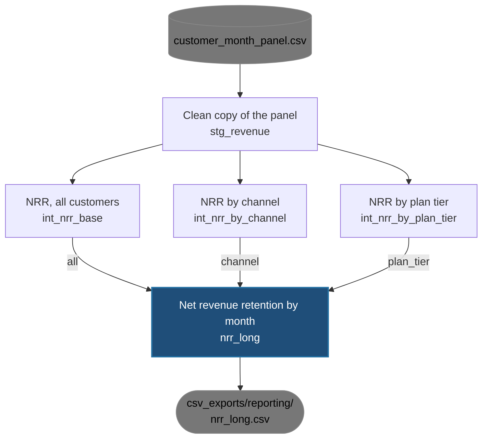
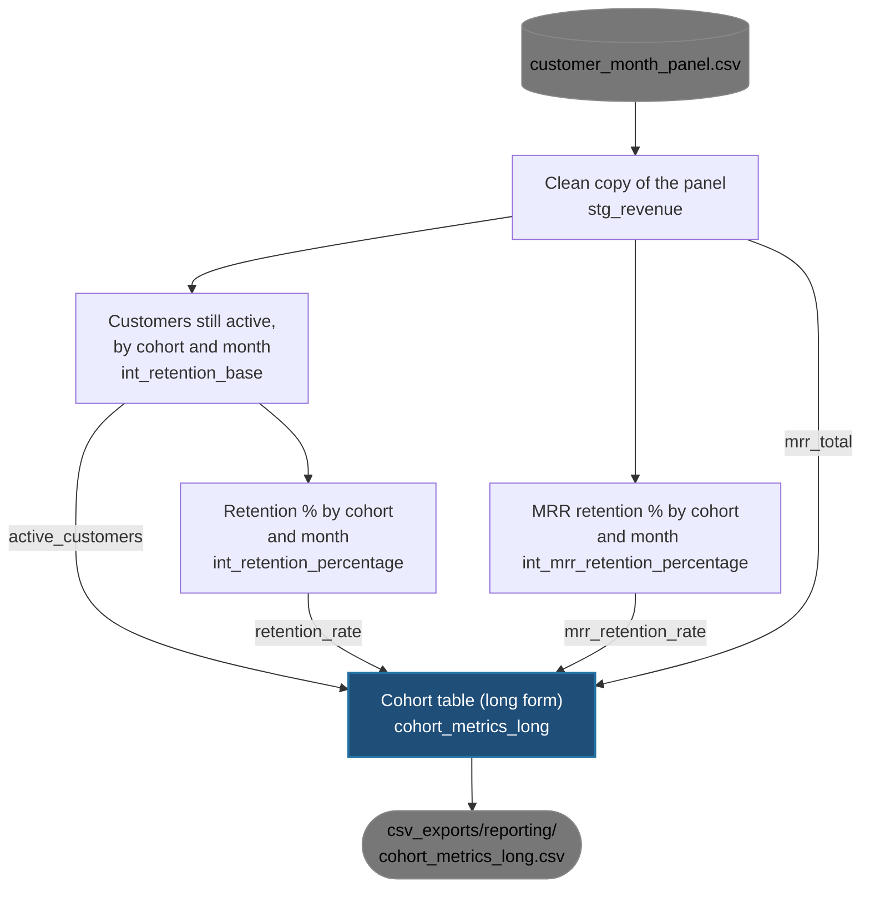
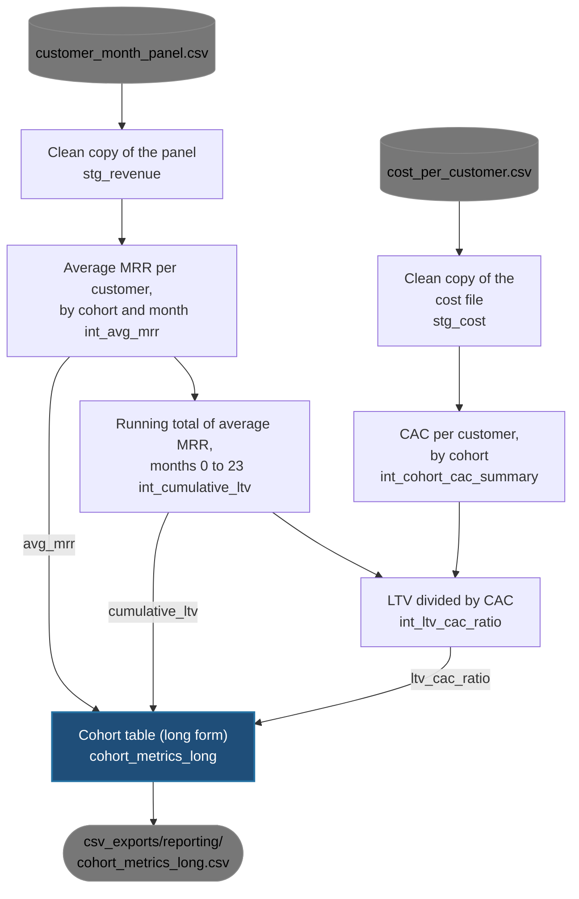
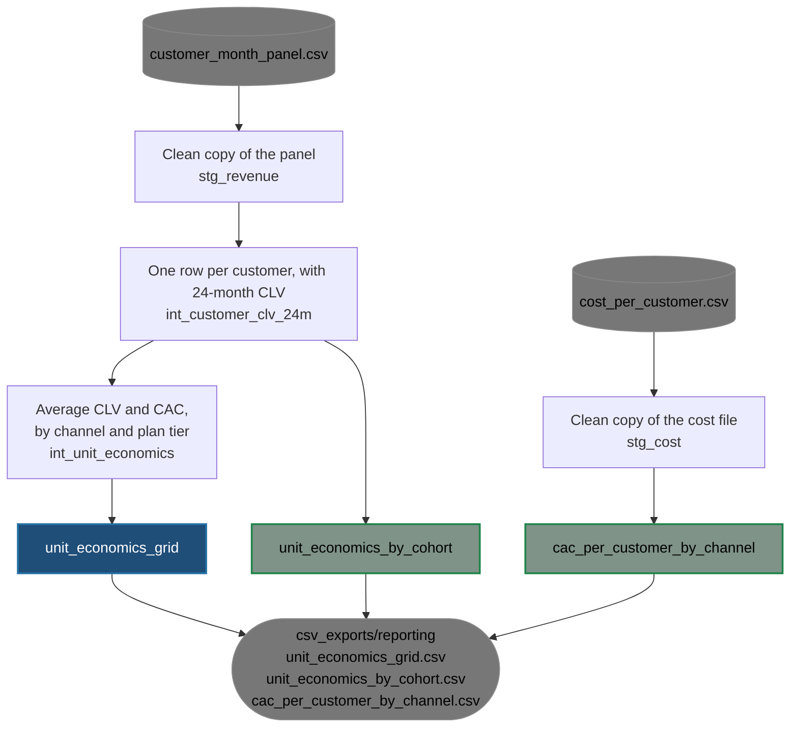
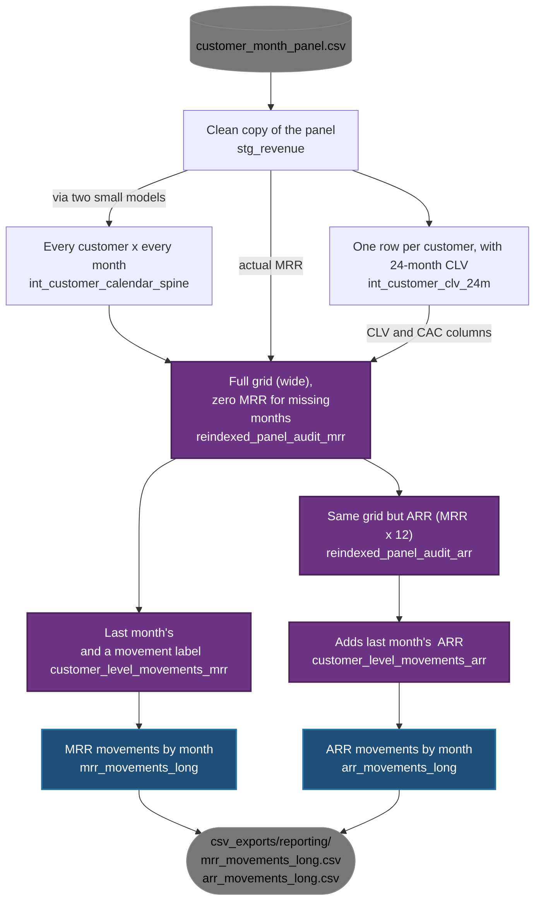
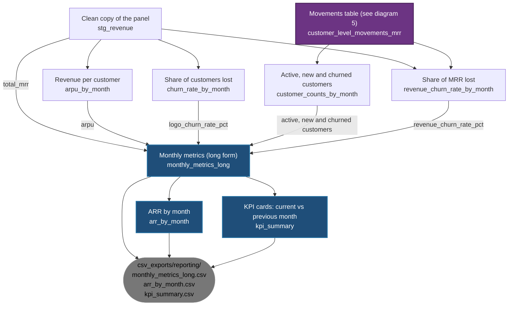

# Where each dashboard table comes from (dbt_to_exports v5a)

**There are six lineage diagrams for each exported csv or parquet file from dbt_to_exports models.  Final tables are the blue boxes in the lineage diagrams, exported as csv file in the pill boxes.**

[Net revenue retention (`nrr_long`)](#net-revenue-retention-nrr-long)

[Cohort retention (`cohort_metrics_long`, part 1 of 2)](#2-cohort-retention-cohort_metrics_long-part-1-of-2)

[Cohort LTV and LTV:CAC (`cohort_metrics_long`, part 2 of 2)](#3-cohort-ltv-and-ltvcac-cohort_metrics_long-part-2-of-2)

[Unit economics and CAC (three tables)](#4-unit-economics-and-cac-three-tables)

[MRR and ARR movements (`mrr_movements_long`, `arr_movements_long`)](#5-mrr-and-arr-movements-mrr_movements_long-arr_movements_long)

[Monthly metrics and KPI cards (`monthly_metrics_long`, `arr_by_month`, `kpi_summary`)](#6-monthly-metrics-and-kpi-cards-monthly_metrics_long-arr_by_month-kpi_summary)

**Legends in this lineage diagram**. 
- Grey disc: a file.
- Dark grey box: table or view
- Purple: one of the four wide customer-by-month tables, stored once as real tables.
- Green: new in v5a vs. v5 dbt_to_exports model
- Blue: the table explained in the section
- Grey pill at the bottom: the csv file exported
- The words on an arrow are the metrics, kpis or segments for that branch.

**Two terms**
- `stg_` models are staging. They are a clean copy of a source file and with rename and cast columns as transformations.
- `int_` models are intermediate building blocks. Dashboards do not read them.

---

## 1. Net revenue retention (`nrr_long`)

Three versions of the same calculation (all customers, by channel, by plan tier) are appended or concatenated into one table.

[Back to top](#where-each-dashboard-table-comes-from-dbt_to_exports-v5a)

---

## 2. Cohort retention (`cohort_metrics_long`, part 1 of 2)

Customer retention and MRR retention, by cohort and months since signup. Part 2 covers the LTV rows of the same table.

[Back to top](#where-each-dashboard-table-comes-from-dbt_to_exports-v5a)

---

## 3. Cohort LTV and LTV:CAC (`cohort_metrics_long`, part 2 of 2)

The same table as diagram 2. LTV stops at month 23, so the last value is the 24-month figure. A cohort with no cost rows has no CAC and drops out of the ratio.

[Back to top](#where-each-dashboard-table-comes-from-dbt_to_exports-v5a)

---

## 4. Unit economics and CAC (three tables)

`unit_economics_grid` has one row per channel and plan tier. `unit_economics_by_cohort` is the same grid with the cohort month kept. `cac_per_customer_by_channel` is CAC per cohort and channel.

[Back to top](#where-each-dashboard-table-comes-from-dbt_to_exports-v5a)

---

## 5. MRR and ARR movements (`mrr_movements_long`, `arr_movements_long`)

The four purple tables are the wide customer-by-month tables. Each customer gets a row for every calendar month, with zero MRR for missing months. The movements tables then label each month as New Business, Expansion, Contraction, Churn or No Change.

The "every customer x every month" box is built from two small models, `int_customer_attributes` and `int_calendar_months`. Both read `stg_revenue`.

[Back to top](#where-each-dashboard-table-comes-from-dbt_to_exports-v5a)

---

## 6. Monthly metrics and KPI cards (`monthly_metrics_long`, `arr_by_month`, `kpi_summary`)

One table of monthly metrics feeds the other two. The purple box is the movements table from diagram 5.

[Back to top](#where-each-dashboard-table-comes-from-dbt_to_exports-v5a)
