# Lineage of the dashboard charts

This document shows where each chart on the dashboard comes from. The dashboard is built only from the CSV files exported by the dbt reporting model. Each diagram covers one chart or one small group of charts, so none of them is a big web.

There are **12 diagrams**, plus a table of every card.

**Legend**
- Grey disc: an export file read by the dashboard.
- Dark grey box: a step the dashboard script does.
- Blue box: a chart card on the page.
- The words on an arrow are the metric, segment or column that moves along that branch.

**Contents**

[1. Big picture](#1-big-picture)

[2. Which exports feed which tab](#2-which-exports-feed-which-tab)

[3. Revenue tab: MRR and ARR](#3-revenue-tab-mrr-and-arr)

[4. Revenue tab: MRR movements](#4-revenue-tab-mrr-movements)

[5. Revenue tab: ARPU and revenue churn](#5-revenue-tab-arpu-and-revenue-churn)

[6. Revenue tab: net revenue retention](#6-revenue-tab-net-revenue-retention)

[7. Revenue tab: revenue retention heatmap](#7-revenue-tab-revenue-retention-heatmap)

[8. Customers tab: active customers and churn](#8-customers-tab-active-customers-and-churn)

[9. Customers tab: CAC by channel](#9-customers-tab-cac-by-channel)

[10. Customers tab: retention heatmaps](#10-customers-tab-retention-heatmaps)

[11. Customers tab: unit economics and payback](#11-customers-tab-unit-economics-and-payback)

[12. Outputs: pages and data files](#12-outputs-pages-and-data-files)

[Table of every card](#table-of-every-card)

---

## 1. Big picture

Every page goes through the same steps. The as-of month removes months that have not happened yet. The timeframe step keeps the months and cohorts in one window, such as 2024-2025.

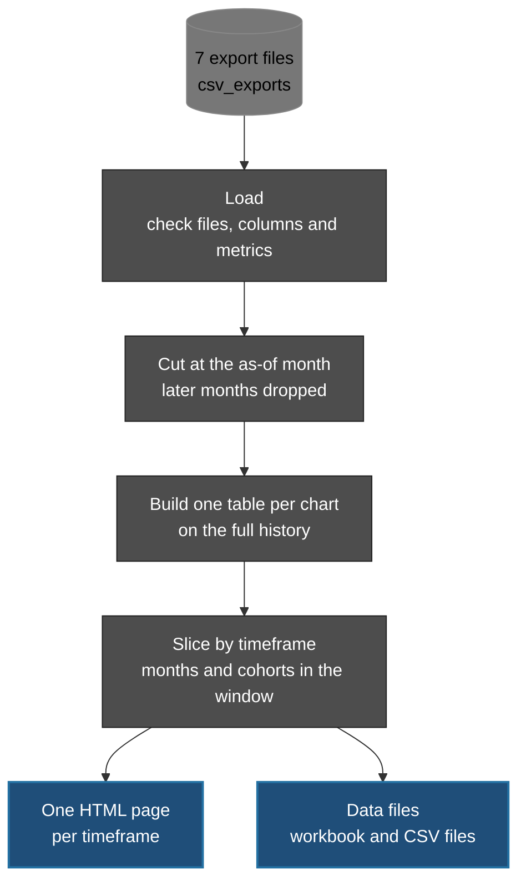
[Back to top](#lineage-of-the-dashboard-charts)

---

## 2. Which exports feed which tab

Five files feed the Revenue tab. Four feed the Customers tab. The monthly metrics file and the cohort file feed both.

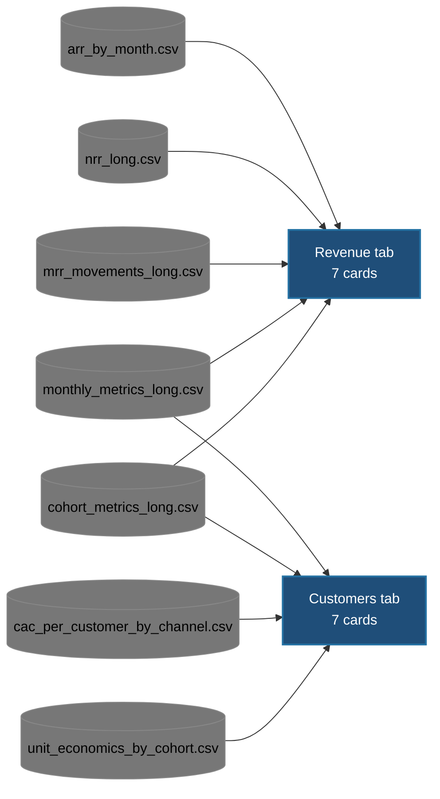

Three more files sit in the export folder and are not read. `arr_movements_long.csv` is the MRR movements times 12. `kpi_summary.csv` is the monthly metrics plus last month's value. `unit_economics_grid.csv` is the by-cohort unit economics added up over all cohorts.

[Back to top](#lineage-of-the-dashboard-charts)

---

## 3. Revenue tab: MRR and ARR

Two cards. Each one shows a line over calendar months, the latest value, the previous value, and the percent change.

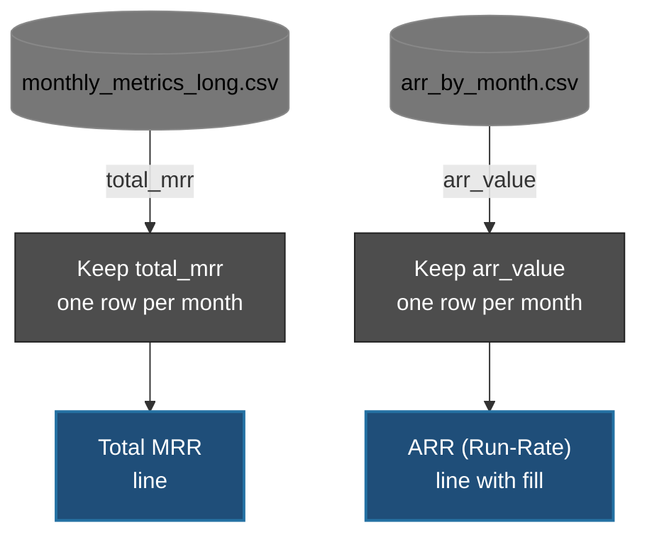
[Back to top](#lineage-of-the-dashboard-charts)

---

## 4. Revenue tab: MRR movements

One card. Two files meet here. The movements give the bars and the net line. The monthly total MRR gives the previous month's MRR, so the hover text can show each movement as a share of it.

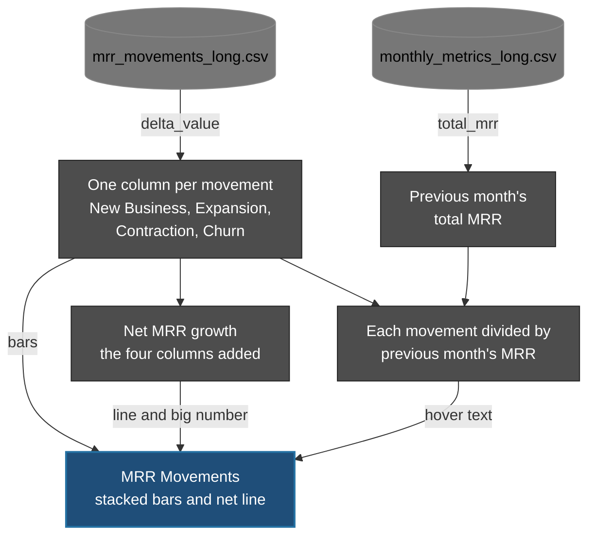
[Back to top](#lineage-of-the-dashboard-charts)

---

## 5. Revenue tab: ARPU and revenue churn

Two cards from the same file. Both are lines over calendar months. For revenue churn, a rise is bad, so the badge turns pink when it goes up.

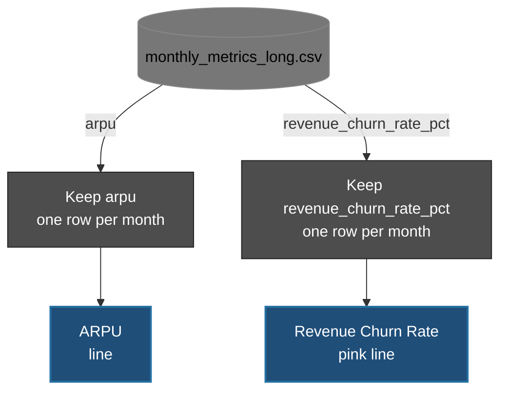
[Back to top](#lineage-of-the-dashboard-charts)

---

## 6. Revenue tab: net revenue retention

One card with three views. The buttons on the card switch between them. All three views read the same file and differ only in the segment.

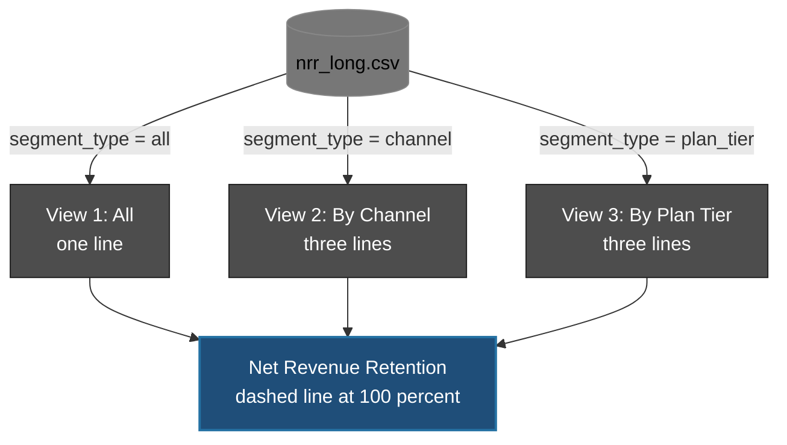
[Back to top](#lineage-of-the-dashboard-charts)

---

## 7. Revenue tab: revenue retention heatmap

One card. The cohort file holds one row per cohort and month of life. The script turns those rows into a grid, with cohorts down the side and months of life across the top. Values above 100 percent mean upsell is larger than churn.

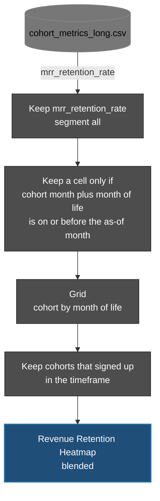
[Back to top](#lineage-of-the-dashboard-charts)

---

## 8. Customers tab: active customers and churn

Two cards from the same file. Customer churn is a pink line, and a higher churn is bad.

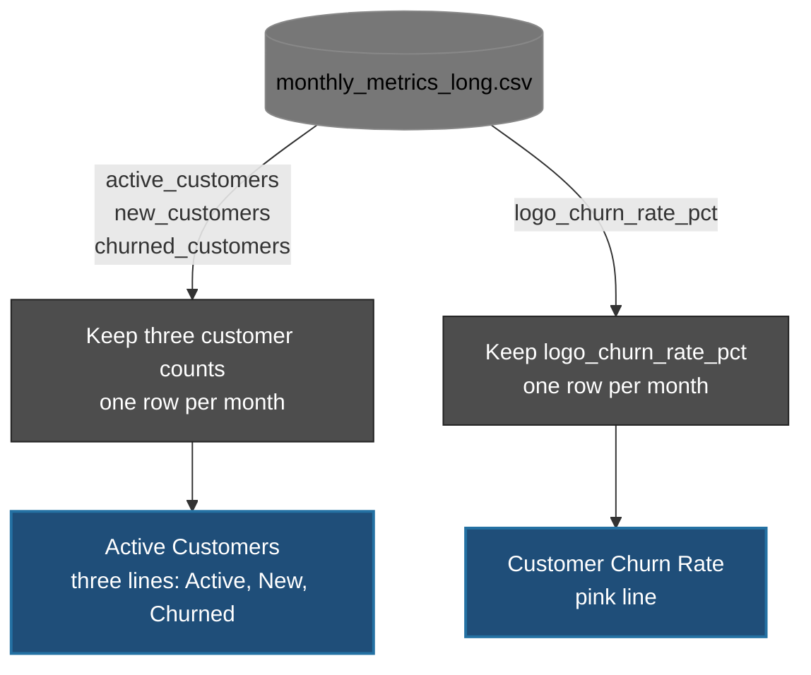
[Back to top](#lineage-of-the-dashboard-charts)

---

## 9. Customers tab: CAC by channel

One card. The lines come straight from the CAC file. The big number is a blended CAC for the latest cohort. It weights each channel's CAC by that channel's signups. The same blended CAC is the starting CAC in the payback table (diagram 11).

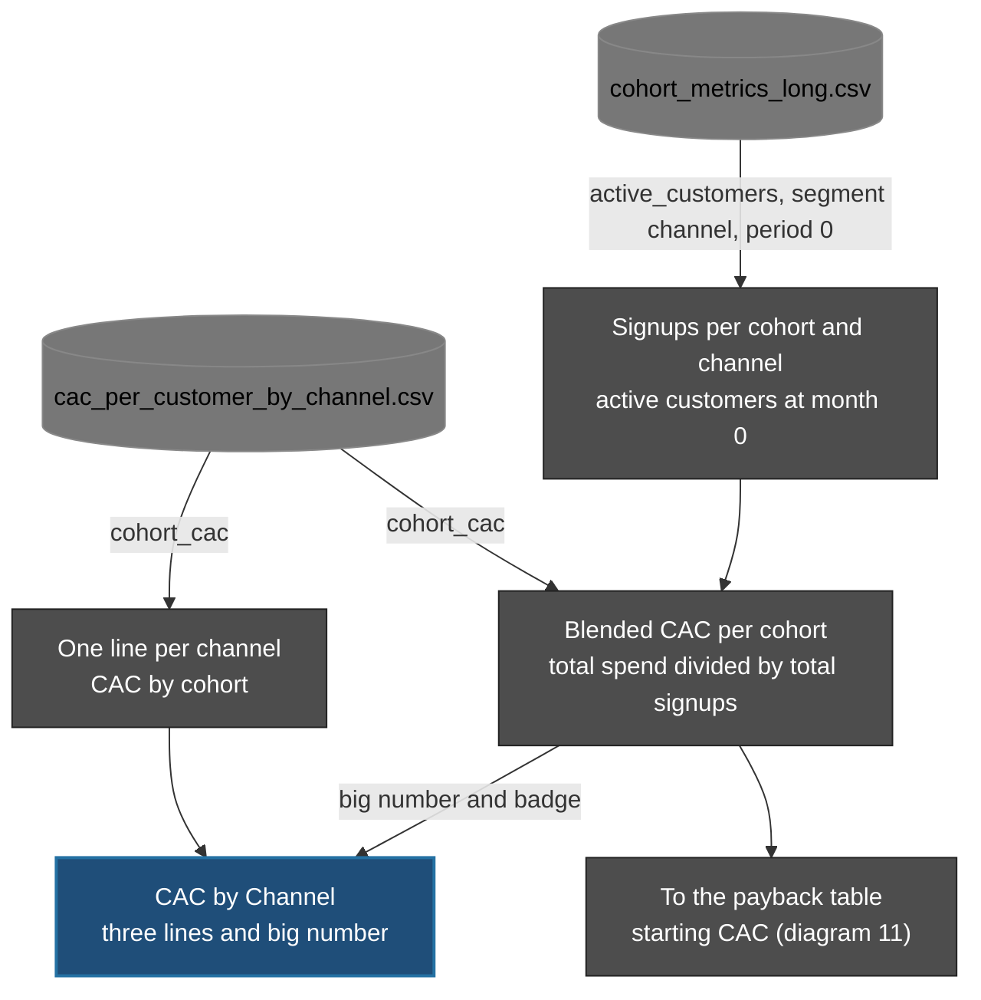
[Back to top](#lineage-of-the-dashboard-charts)

---

## 10. Customers tab: retention heatmaps

Two cards from one metric. The blended card uses the all-customers rows. The segment card has two views, one for channels and one for plan tiers, each with three heatmaps side by side. Every heatmap goes through the same cut at the as-of month and the same timeframe filter, so each branch ends with one grid.

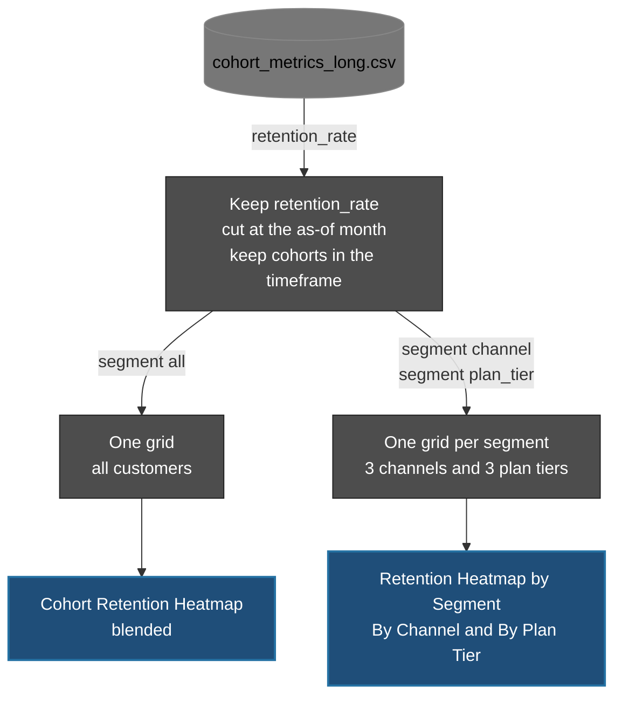
[Back to top](#lineage-of-the-dashboard-charts)

---

## 11. Customers tab: unit economics and payback

Two tables. The unit economics table starts from the by-cohort file. Only mature cohorts are kept. A cohort is mature when it has lived through 24 months by the as-of month. Rows are weighted by their mature customers, so each customer counts once. The payback table finds the month each cohort earns back its CAC.

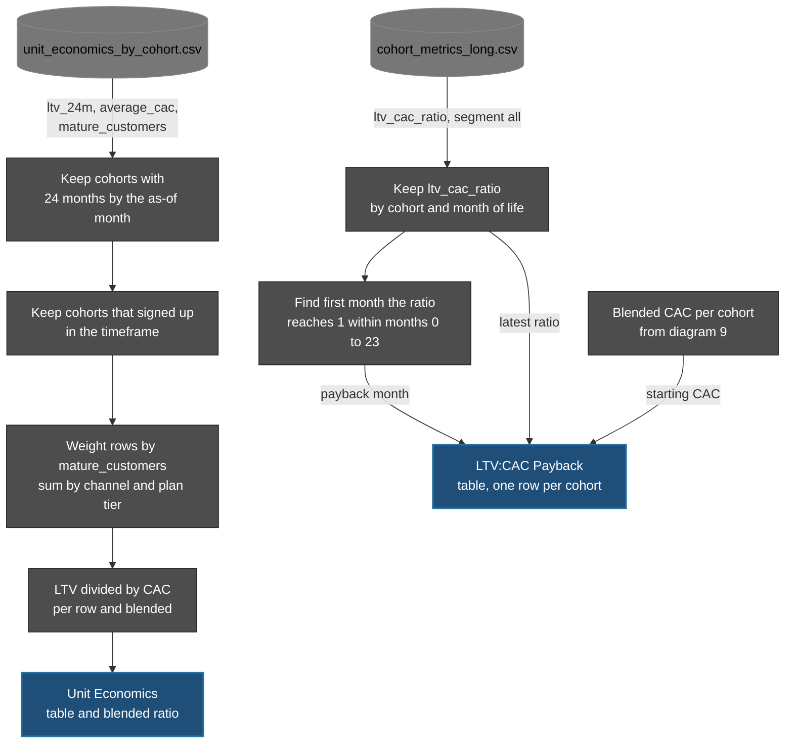
[Back to top](#lineage-of-the-dashboard-charts)

---

## 12. Outputs: pages and data files

The same tables feed the pages and the data files, so the numbers in the files match what each page shows.

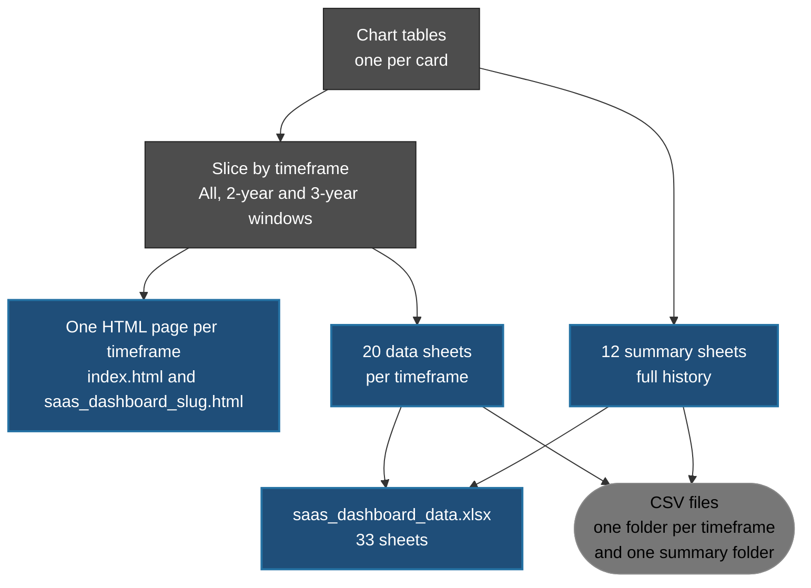
[Back to top](#lineage-of-the-dashboard-charts)

---

## Table of every card

| Tab | Card | Chart | Export files read | Diagram |
|---|---|---|---|---|
| Revenue | Total MRR | Line | `monthly_metrics_long` | 3 |
| Revenue | ARR (Run-Rate) | Line with fill | `arr_by_month` | 3 |
| Revenue | MRR Movements | Stacked bars and net line | `mrr_movements_long`, `monthly_metrics_long` | 4 |
| Revenue | ARPU | Line | `monthly_metrics_long` | 5 |
| Revenue | Revenue Churn Rate | Line | `monthly_metrics_long` | 5 |
| Revenue | Net Revenue Retention | Three line views | `nrr_long` | 6 |
| Revenue | Revenue Retention Heatmap (blended) | Heatmap | `cohort_metrics_long` | 7 |
| Customers | Active Customers | Three lines | `monthly_metrics_long` | 8 |
| Customers | Customer Churn Rate | Line | `monthly_metrics_long` | 8 |
| Customers | CAC by Channel | Three lines | `cac_per_customer_by_channel`, `cohort_metrics_long` | 9 |
| Customers | Cohort Retention Heatmap (blended) | Heatmap | `cohort_metrics_long` | 10 |
| Customers | Retention Heatmap by Segment | Two views of three heatmaps | `cohort_metrics_long` | 10 |
| Customers | Unit Economics | Table | `unit_economics_by_cohort` | 11 |
| Customers | LTV:CAC Payback | Table | `cohort_metrics_long`, `cac_per_customer_by_channel` | 11 |

[Back to top](#lineage-of-the-dashboard-charts)
